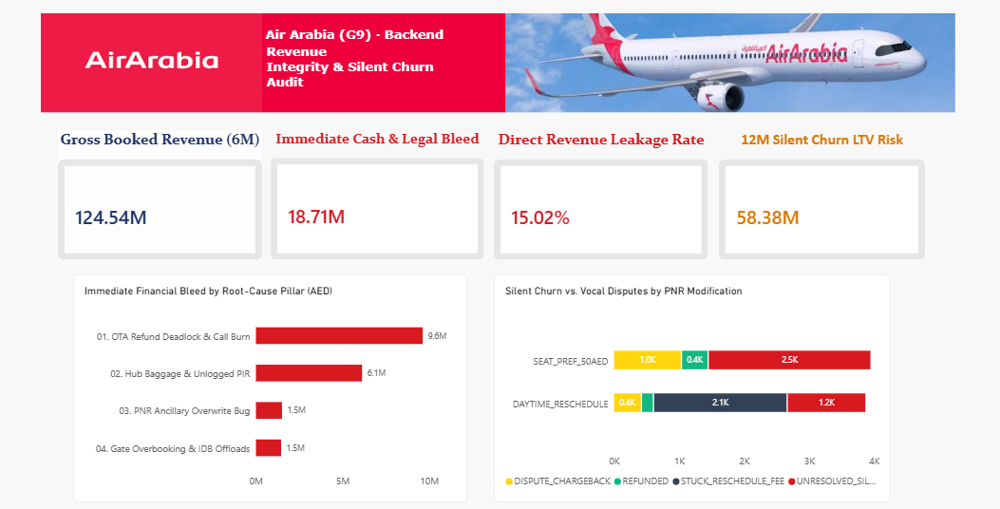
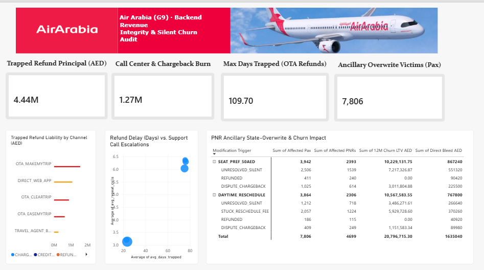
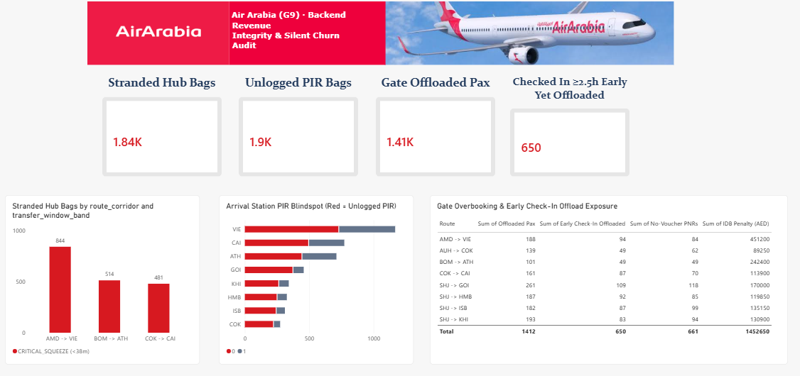

# Air Arabia (G9): Backend Revenue Integrity & Silent Churn Forensic Audit

## Executive Summary
While headline seat load factors (83%–85%) indicate strong top-line demand, operational telemetry across **65,000 Passenger Name Records (PNRs)**, **2,400 flights**, and **82,703 checked baggage tags** exposes severe backend revenue erosion caused by asynchronous software states, third-party Online Travel Agency (OTA) settlement deadlocks, and compressed hub transfer windows.

Constructed through **empirical complaint-driven telemetry modeling**—calibrating verified passenger incident logs against **IATA Resolution 753**, **EU Regulation (EC) 261/2004**, **Montreal Convention**, and **UAE GCAA** liability frameworks—this audit evaluates a 6-month gross ticket revenue baseline of **AED 124.54M ($33.91M USD)**. Four isolated workflow failures account for **AED 18.71M ($5.09M USD)** in immediate cash leakage and statutory legal exposure (**15.02% direct revenue erosion**), alongside **AED 58.38M ($15.90M USD)** in projected 12-month repeat-booking churn LTV.

> **Intellectual Property & Remediation Notice:** To protect proprietary audit logic, raw SQL schema definitions, anomaly-detection queries, Python ingestion scripts, and automated database remediation architectures are withheld from this public repository. Full technical walkthroughs are available exclusively during executive briefings or technical interviews (`motiwala603@gmail.com`).

---

## Master Financial Exposure Matrix (6-Month Audit Window)

| Root-Cause Failure Pillar | Impacted Bookings | Direct Cash & Trapped Funds (AED) | Statutory Legal Exposure (AED) | Total Immediate Bleed (AED) | Projected 12M Churn LTV Risk (AED) |
| :--- | :---: | :---: | :---: | :---: | :---: |
| **01. OTA Refund Deadlocks & Support Burn** | 5,471 | 5,709,434.43 | 3,919,200.00 | **9,628,634.43** | 13,000,137.05 |
| **02. Sharjah (`SHJ`) Hub Baggage & Unlogged PIRs** | 2,797 | 946,798.78 | 5,179,294.76 | **6,126,093.54** | 20,647,818.89 |
| **03. PNR Ancillary State-Overwrite Bug** | 4,699 | 1,503,700.00 | 0.00 | **1,503,700.00** | 20,796,715.30 |
| **04. Gate Overbooking & Early Check-In Offloads** | 838 | 0.00 | 1,452,650.00 | **1,452,650.00** | 3,938,732.30 |
| **TOTAL EXPOSURE (6 MONTHS)** | **13,805** | **8,159,933.21** | **10,551,144.76** | **18,711,077.97** | **58,383,403.54** |

---

## Diagnostic Breakdown of the Four Operational Leaks

### 1. The OTA API Settlement Deadlock (`AED 9.63M` Immediate Exposure)
* **Direct vs. OTA Settlement Latency:** Direct web/app bookings settle refunds within **8.1 days** on average (`0.5` support calls per case), whereas cancelled itineraries booked via third-party OTAs (`MakeMyTrip`, `Cleartrip`, `EaseMyTrip`) stall in `UNRECONCILED_OTA_HOLD` states for **103.3 to 106.1 days**.
* **Call-Center Payroll Burn:** **AED 4.44M** in trapped ticket principal remains un-reconciled, provoking **16.2 to 16.9 repeat escalation calls per case** and burning **AED 1.27M** in internal support payroll (`AED 35/call`) and merchant chargeback fees (`AED 90/dispute`), alongside **AED 3.92M** in statutory penalties.

### 2. Sharjah (`SHJ`) Hub Transfer Squeeze & PIR Blindspots (`AED 6.13M` Exposure)
* **The 38-Minute Connection Cliff:** Across connecting corridors (`AMD–SHJ–VIE`, `BOM–SHJ–ATH`, `COK–SHJ–CAI`), baggage stranding sits at **0.00%** when hub transfer windows hold at `>= 38 minutes`, but spikes to **32.37%–35.98%** (**1,839 stranded bags**) when inbound delays compress connections below **38 minutes**.
* **Station-Level PIR Compliance Failure:** Under IATA Resolution 753 custody tracking, **58.6% (1,900 of 3,244 stranded or damaged bags)** lacked a digital Property Irregularity Report (`PIR`) at destination desks (`VIE`, `ATH`, `CAI`, `GOI`, `KHI`, `HMB`), creating unmonitored recovery black holes and **AED 5.18M** in Montreal Convention / EU261 liability.

### 3. PNR Ancillary State-Overwrite Bug & "Silent Churn" (`64.3%` Silent Defection)
* **Database State Anomaly:** When passengers with prepaid luggage execute a secondary PNR modification—such as adding an **AED 50 seat preference** or rescheduling to a daytime flight—a non-additive database update overwrites their check-in baggage allowance to `0 kg`, forcing duplicate gate payments (**AED 1.50M** unreleased).
* **The Silent Majority:** **64.31%** of overcharged seat-preference passengers absorb the duplicate airport fee without filing a formal dispute (`UNRESOLVED_SILENT`), quietly churning (**AED 20.80M** in 12-month repeat-booking LTV loss at 2.4 trips/year)—proving public complaints represent less than one-third of actual customer damage.

### 4. Involuntary Denied Boarding (IDB) & Early Check-In Offloads (`AED 1.45M` Legal Exposure)
* **Unvouchered Gate Offloads:** Across high-density corridors (`SHJ–GOI`, `SHJ–KHI`, `AMD–VIE`), **1,412 passengers** were involuntarily offloaded at the gate—**46.0% (650 travelers)** of whom had checked in **at least 2.5 hours prior to departure**, yet **74.7%–86.1%** received zero automated hotel or rebooking vouchers.

---

## Executive Dashboard Architecture (Power BI)

### Page 01 · Executive Revenue Integrity Command

### Page 02 · OTA Settlement Deadlocks & PNR Overwrite Forensics

### Page 03 · Sharjah (`SHJ`) Hub Squeeze & Gate Offload Telemetry

---

## Repository Contents & Scope Disclaimer
* `Forensic Operations and Revenue Integrity Report.pdf` — Full executive audit report & visual breakdown.
* `SourceCode.sql` — Schema architecture overview & executive briefing notice (remediation logic restricted).
* `/dashboard/` — High-resolution exports of the 3-page Power BI executive command dashboard.

**Analytical Scope Disclaimer:** This is an independent operational analytics audit constructed via empirical complaint-driven telemetry modeling across 203,389 relational records calibrated to Air Arabia (`G9`) hub networks (`SHJ`/`AUH`) and international aviation regulatory frameworks. Financial figures represent model-derived exposure estimates rather than official Air Arabia accounting disclosures.
